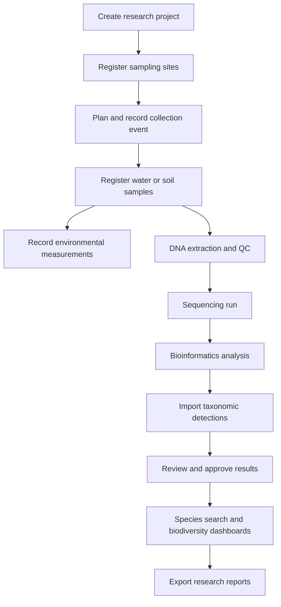
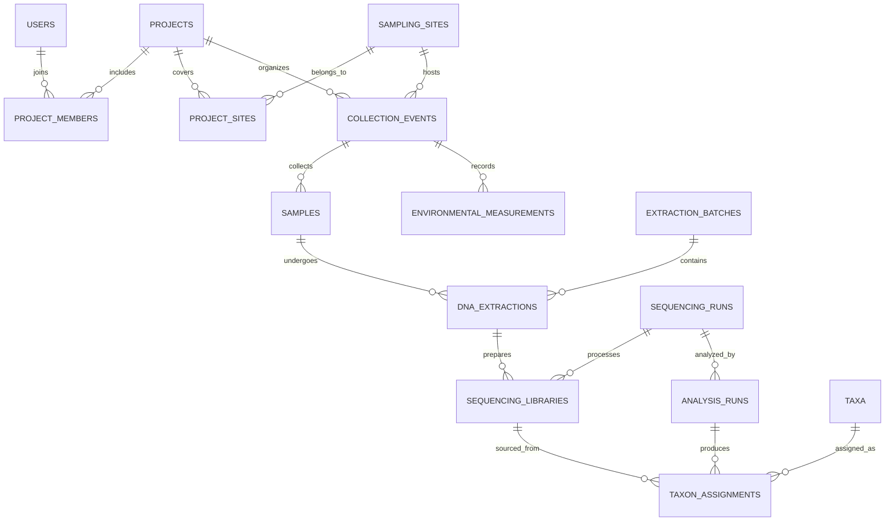

# eBioTrack — eDNA Biodiversity Intelligence Platform

> A database-first research management and biodiversity analytics web application for environmental DNA (eDNA) studies.


> **Project status:** This README describes the proposed design and scope. The schema, queries, and application below are the plan for the semester project; they are not yet implemented. Progress is tracked in the [roadmap](#implementation-roadmap).

---

## Table of contents

1. [Overview](#overview)
2. [Problem statement](#problem-statement)
3. [Who it is for](#who-it-is-for)
4. [Objectives](#objectives)
5. [Workflow](#end-to-end-workflow)
6. [Modules](#application-modules)
7. [Tech stack](#tech-stack)
8. [Database design](#database-design)
9. [DBMS concepts covered](#dbms-concepts-covered)
10. [Example SQL](#example-sql-queries)
11. [Transactions, triggers, indexing](#transactions-triggers-and-indexing)
12. [Frontend pages](#frontend-pages)
13. [API sketch](#api-sketch)
14. [Optional ML component](#optional-ml-component)
15. [Data sourcing](#data-sourcing-and-import)
16. [Example use case](#example-use-case)
17. [Repository structure](#repository-structure)
18. [Implementation roadmap](#implementation-roadmap)
19. [Testing and evaluation](#testing-and-evaluation)
20. [Demo plan](#semester-final-demonstration-plan)
21. [Feasibility and limitations](#feasibility-and-limitations)
22. [Future enhancements](#future-enhancements)

---

## Overview

eBioTrack manages the full lifecycle of environmental DNA research: projects, field sites, collection events, samples, laboratory processing, sequencing runs, bioinformatics analyses, species detections, and biodiversity trends.

It combines a React interface, a Node.js/Express API, and a PostgreSQL relational database. An optional Python service supports exploratory anomaly detection.

| | |
|---|---|
| **Project type** | DBMS semester-end full-stack project |
| **Primary focus** | Relational modeling, integrity, complex SQL, transactions, indexing, security, analytics |
| **Stack** | React, TypeScript/JavaScript, Node.js, Express, PostgreSQL, optional Python/scikit-learn |

**Core principle:** eBioTrack is a **DBMS-centered environmental research platform**, not merely a dashboard or a machine-learning classifier.

## Problem statement

eDNA projects generate related data across field sampling, laboratory work, sequencing, taxonomy, and environmental measurements. That data tends to be scattered across spreadsheets, result files, and notebooks. This makes it hard to trace a detection back to its sample, compare sites consistently, audit changes, or analyze trends over time.

**Solution:** a centralized, relational, role-aware platform that links every step of the workflow and exposes searchable records, reproducible analyses, maps, and historical biodiversity dashboards.

## Who it is for

| User | Needs | eBioTrack benefit |
|---|---|---|
| Field researcher | Register sites, events, samples | Standardized sample provenance |
| Lab technician | Track extraction, QC, sequencing | Traceable processing history |
| Bioinformatics analyst | Import and review taxonomic assignments | Versioned, queryable detection results |
| Principal investigator | Coordinate projects and collaborators | Project oversight and access control |
| Conservation researcher | Compare biodiversity across sites and time | Trend dashboards and exports |
| Administrator | Manage users, permissions, audit trails | Reliable governance |

eBioTrack is a research workflow and analysis system. It is not a DNA sequencing instrument or a substitute for scientific validation.

## Objectives

1. Model a scientifically plausible eDNA workflow with normalized relational tables.
2. Preserve provenance from a detection back to its analysis run, sample, event, and site.
3. Support reliable multi-user data entry with constraints, transactions, and audit history.
4. Enable complex species, location, time, and environmental queries.
5. Visualize biodiversity records through dashboards and maps.
6. Import representative real or synthetic datasets.
7. Optionally explore ML-based anomaly detection.

## End-to-end workflow



A sequencing run can contain multiple libraries, and a sample can be reprocessed or reanalyzed. The schema preserves these many-to-many and versioning relationships instead of assuming a one-to-one pipeline.

## Application modules

### Authentication and roles
- Login, sessions, password hashing, role-based permissions.
- Roles: administrator, principal investigator, field researcher, lab technician, analyst, viewer.
- Project-specific membership and permissions.

### Project and site management
- Create projects and invite members.
- Define study areas, geolocated sampling sites, habitat types, and site metadata.
- View sampling sites on a map.

### Field sample management
- Register collection events and samples with unique identifiers.
- Record date, collector, sample type, depth, storage details, and environmental conditions.
- Track sample state and handling history.

### Laboratory workflow
- Record extraction batches and extraction records.
- Capture QC measurements and lab notes.
- Link extracted material to sequencing libraries and runs.
- Flag failed or contaminated controls.

### Analysis and taxonomy
- Record pipeline, version, marker, reference database, and run parameters.
- Import taxonomic detections from CSV.
- Store assignments with confidence and quality metrics.
- Require review and approval before results reach published dashboards.

### Biodiversity intelligence
- Detections by site, period, project, or habitat.
- Observed taxon richness and detection frequency.
- Comparison of matched sampling periods and methods.
- Filtered CSV report downloads.

> **Scientific caveat:** eDNA detection does not establish organism abundance or confirmed absence. A non-detection can result from sampling effort, assay sensitivity, or analysis choices. Reports should show uncertainty, effort, and quality flags.

### Optional ML module
- Detect unusual changes in observed richness or detection profiles.
- Store model versions, input dataset versions, predictions, and evaluation metrics.
- Label all output as exploratory, not verified species occurrences.

## Tech stack

| Layer | Technology | Purpose |
|---|---|---|
| Frontend | React + TypeScript | Interactive web interface |
| UI | Tailwind CSS | Styling |
| Charts | Recharts | Trend visualization |
| Maps | Leaflet + OpenStreetMap | Sampling site map |
| API | Node.js + Express | Validation, workflows, endpoints |
| Database | PostgreSQL | Relational storage and SQL |
| Geospatial (optional) | PostGIS | Geographic search |
| DB access | `pg` or a query builder | Parameterized SQL |
| Auth | Secure cookie-based sessions | Login and authorization |
| ML (optional) | Python, pandas, scikit-learn | Exploratory modeling |
| Version control | Git + GitHub | Collaboration |

## Database design

The proposed design has about **25 core tables**. Names and boundaries will be refined during normalization.

<details>
<summary><strong>Proposed tables (click to expand)</strong></summary>

| # | Table | Key columns / purpose |
|---|---|---|
| 1 | `users` | `user_id` PK, name, email, password_hash, active |
| 2 | `roles` | `role_id` PK, role_name |
| 3 | `user_roles` | `user_id` FK, `role_id` FK |
| 4 | `projects` | `project_id` PK, title, objectives, start_date, status |
| 5 | `project_members` | `project_id` FK, `user_id` FK, project_role |
| 6 | `regions` | `region_id` PK, name, region_type, parent_region_id FK |
| 7 | `sampling_sites` | `site_id` PK, region_id FK, name, latitude, longitude, habitat_type |
| 8 | `project_sites` | `project_id` FK, `site_id` FK |
| 9 | `collection_events` | `event_id` PK, project_id FK, site_id FK, collector_id FK, collected_at |
| 10 | `sample_types` | `sample_type_id` PK, type_name |
| 11 | `samples` | `sample_id` PK, event_id FK, sample_type_id FK, sample_code, status |
| 12 | `environmental_measurements` | `measurement_id` PK, event_id FK, parameter, value, unit |
| 13 | `laboratories` | `lab_id` PK, name, location |
| 14 | `extraction_batches` | `batch_id` PK, lab_id FK, operator_id FK, extraction_date |
| 15 | `dna_extractions` | `extraction_id` PK, sample_id FK, batch_id FK, concentration, qc_status |
| 16 | `sequencing_runs` | `run_id` PK, lab_id FK, platform, run_date, status |
| 17 | `sequencing_libraries` | `library_id` PK, extraction_id FK, run_id FK, library_code |
| 18 | `dna_markers` | `marker_id` PK, marker_name, target_region |
| 19 | `analysis_runs` | `analysis_id` PK, run_id FK, marker_id FK, pipeline_version, reference_db, status |
| 20 | `taxa` | `taxon_id` PK, scientific_name, rank, parent_taxon_id FK |
| 21 | `taxon_assignments` | `assignment_id` PK, analysis_id FK, library_id FK, taxon_id FK, read_count, confidence, qc_flag |
| 22 | `quality_control_results` | `qc_id` PK, sample_id FK nullable, analysis_id FK nullable, qc_type, result |
| 23 | `sample_status_history` | `history_id` PK, sample_id FK, old_status, new_status, changed_by FK, changed_at |
| 24 | `audit_logs` | `audit_id` PK, actor_id FK, entity_type, entity_id, action, created_at |
| 25 | `data_exports` | `export_id` PK, requested_by FK, project_id FK, export_type, created_at |

</details>

**Planned constraints:** unique sample codes; non-negative values where appropriate; valid coordinate ranges; foreign keys; composite unique keys on junction tables; valid status transitions. For stronger provenance, analysis inputs should be linked more precisely than at run level when libraries are reused across analyses.

### Key relationships

- `users` M:N `roles` via `user_roles`
- `users` M:N `projects` via `project_members`
- `projects` M:N `sampling_sites` via `project_sites`
- `sampling_sites` 1:N `collection_events`
- `collection_events` 1:N `samples` and 1:N `environmental_measurements`
- `samples` 1:N `dna_extractions` (supports repeats)
- `extraction_batches` 1:N `dna_extractions`
- `dna_extractions` 1:N `sequencing_libraries`
- `sequencing_runs` 1:N `sequencing_libraries` and 1:N `analysis_runs`
- `analysis_runs` 1:N `taxon_assignments`
- `taxa` 1:N `taxon_assignments`; `taxa` is self-referencing for the taxonomy hierarchy
- `samples` 1:N `sample_status_history`

### Simplified ER diagram



## DBMS concepts covered

| Concept | Demonstration in eBioTrack |
|---|---|
| ER/EER modeling | Entity relationships, user role specialization, sample workflow |
| Keys and constraints | PK, FK, UNIQUE, CHECK, NOT NULL |
| Normalization | Decompose flat sample/species/site records into 3NF/BCNF |
| Relational algebra | Selection, projection, joins, set operations |
| Complex SQL | Multi-table joins, correlated subqueries, CTEs, aggregation |
| Views | Approved detections, project sample summaries, site richness |
| Indexes | Sample code, collection date, project/site, taxon lookup |
| Stored procedures/functions | Register sample, finalize analysis, calculate site metrics |
| Triggers | Audit important changes, enforce workflow transitions |
| Transactions | Atomic result import and analysis finalization |
| Concurrency | Prevent double finalization and conflicting edits |
| Authorization | Role and project-level access checks |
| Backup/recovery | `pg_dump`, restore demonstration, recovery notes |
| Data warehousing | Optional star schema for historical trends |
| NoSQL | Optional; PostgreSQL JSONB may suffice |

A large table count alone does not demonstrate good design. Normalization, realistic constraints, correct joins, repeatable tests, and query plans matter more.

## Example SQL queries

### Taxa detected at a site

```sql
SELECT DISTINCT t.taxon_id, t.scientific_name
FROM taxa t
JOIN taxon_assignments ta ON ta.taxon_id = t.taxon_id
JOIN sequencing_libraries sl ON sl.library_id = ta.library_id
JOIN dna_extractions de ON de.extraction_id = sl.extraction_id
JOIN samples s ON s.sample_id = de.sample_id
JOIN collection_events ce ON ce.event_id = s.event_id
JOIN analysis_runs ar ON ar.analysis_id = ta.analysis_id
WHERE ce.site_id = $1
  AND ar.status = 'approved'
  AND ta.qc_flag = 'pass';
```

### Sample count per site

```sql
SELECT ss.name, COUNT(s.sample_id) AS sample_count
FROM sampling_sites ss
LEFT JOIN collection_events ce ON ce.site_id = ss.site_id
LEFT JOIN samples s ON s.event_id = ce.event_id
GROUP BY ss.site_id, ss.name
ORDER BY sample_count DESC;
```

### Taxon richness by site and year (illustrative)

```sql
SELECT ce.site_id,
       EXTRACT(YEAR FROM ce.collected_at) AS year,
       COUNT(DISTINCT ta.taxon_id) AS observed_taxa
FROM taxon_assignments ta
JOIN analysis_runs ar ON ar.analysis_id = ta.analysis_id
JOIN sequencing_libraries sl ON sl.library_id = ta.library_id
JOIN dna_extractions de ON de.extraction_id = sl.extraction_id
JOIN samples s ON s.sample_id = de.sample_id
JOIN collection_events ce ON ce.event_id = s.event_id
WHERE ar.status = 'approved'
  AND ta.qc_flag = 'pass'
GROUP BY ce.site_id, EXTRACT(YEAR FROM ce.collected_at)
ORDER BY ce.site_id, year;
```

For scientific comparisons, also control for marker, pipeline, effort, replication, and quality thresholds. Repeated analyses can otherwise inflate reported richness.

## Transactions, triggers, and indexing

### Transaction: approving an analysis

Perform these steps atomically:

1. Verify analyst permissions and QC results.
2. Lock the analysis record (`SELECT ... FOR UPDATE`).
3. Validate and insert accepted detection rows.
4. Mark the analysis as approved.
5. Write an audit event.
6. Commit, or roll back everything on failure.

### Triggers

- Write an audit entry after sample status changes.
- Reject invalid workflow transitions.
- Block edits to approved results except through a controlled revision workflow.

### Suggested indexes

```sql
CREATE UNIQUE INDEX idx_samples_code ON samples(sample_code);
CREATE INDEX idx_events_site_date ON collection_events(site_id, collected_at);
CREATE INDEX idx_assignments_taxon ON taxon_assignments(taxon_id);
CREATE INDEX idx_assignments_analysis ON taxon_assignments(analysis_id);
```

Measure index effects with `EXPLAIN (ANALYZE, BUFFERS)` on a sufficiently large test dataset.

## Frontend pages

| # | Page | Purpose |
|---|---|---|
| 1 | Login / access control | Sign in and project permissions |
| 2 | Dashboard | Projects, sites, samples, approved detections, recent activity |
| 3 | Projects | Create, edit, manage collaborators |
| 4 | Sampling map | Interactive site map and filters |
| 5 | Collection events | Field event forms and environmental measurements |
| 6 | Samples | Searchable registry, detail page, status timeline |
| 7 | Lab processing | Extraction, QC, sequencing workflow |
| 8 | Analysis import | Upload CSV, preview errors, validate, commit |
| 9 | Species explorer | Taxonomy, detected sites, detection history |
| 10 | Biodiversity analytics | Site/time comparisons, exportable charts |
| 11 | Administration | Users, roles, audit records, backups |
| 12 | ML insights (optional) | Anomalies, predictions, model limitations |

## API sketch

| Method | Endpoint | Action |
|---|---|---|
| `POST` | `/api/auth/login` | Authenticate |
| `GET` | `/api/projects` | List accessible projects |
| `POST` | `/api/projects` | Create project |
| `GET` | `/api/sites` | Filter sampling sites |
| `POST` | `/api/events` | Register collection event |
| `POST` | `/api/samples` | Register sample |
| `GET` | `/api/samples/:id` | Sample detail and history |
| `POST` | `/api/extractions` | Register DNA extraction |
| `POST` | `/api/analyses/import` | Validate result import |
| `POST` | `/api/analyses/:id/approve` | Transactional approval |
| `GET` | `/api/taxa/:id/detections` | Detection history |
| `GET` | `/api/analytics/richness` | Richness by site/period |
| `GET` | `/api/audit` | Authorized audit history |

Every protected endpoint needs input validation, parameterized queries, pagination, consistent errors, and server-side authorization.

## Optional ML component

**First model: anomaly detection.** Inputs are standardized site/period richness, environmental variables, and sampling effort. Output is a flag for observations that differ substantially from comparable history.

```text
Approved PostgreSQL records
       ↓
Feature extraction and quality filters
       ↓
Python model training / evaluation
       ↓
Model version + anomaly scores
       ↓
Stored results in PostgreSQL
       ↓
Dashboard with caveats
```

With sparse data, use transparent statistical thresholds or skip ML. Never treat a non-detection as confirmed absence, and do not present predicted probabilities as calibrated without validation.

## Data sourcing and import

Candidate public sources:

- [OBIS](https://obis.org/): ocean biodiversity occurrence data, including DNA-derived datasets.
- [GBIF](https://www.gbif.org/): biodiversity occurrence and DNA-derived data.
- [NCBI SRA](https://www.ncbi.nlm.nih.gov/sra): raw sequencing archives (advanced; not needed for the MVP).

**Plan:** start with a curated CSV fixture and synthetic workflow records, then import a suitably licensed public dataset whose fields map cleanly to the schema. Keep source attribution, license, identifiers, and a real-vs-synthetic marker on every record. Do not fabricate missing metadata, and label simulated records clearly.

## Example use case

A researcher creates **Yamuna Biodiversity Survey**, registers several sampling sites, records monthly water collection events, and uploads validated analysis results. The platform links each taxonomic assignment to its sample, sequencing run, collection date, and site. The researcher filters for a taxon, compares approved detections across sites, reviews environmental conditions, and exports a report. An administrator can trace who changed each record.

This is an illustrative workflow, not a claim that such a dataset has been collected.

## Repository structure

Planned layout:

```text
ebiotrack/
├── frontend/
│   ├── src/components/
│   ├── src/pages/
│   ├── src/services/
│   └── src/hooks/
├── backend/
│   ├── src/routes/
│   ├── src/controllers/
│   ├── src/services/
│   ├── src/middleware/
│   └── src/db/
├── database/
│   ├── migrations/
│   ├── seeds/
│   ├── views/
│   ├── procedures/
│   ├── triggers/
│   └── queries/
├── ml/                      # optional
├── datasets/
├── docs/
│   ├── er-diagram.md
│   ├── normalization.md
│   ├── api.md
│   └── dbms-demonstration.md
├── tests/
└── README.md
```

## Implementation roadmap

| Phase | Deliverable | Priority | Status |
|---|---|---|---|
| 1 | Requirements, ER/EER model, normalization report | Essential | ⬜ |
| 2 | PostgreSQL schema, constraints, seed data | Essential | ⬜ |
| 3 | Auth, projects, sites, sample registry APIs | Essential | ⬜ |
| 4 | React project/site/sample management UI | Essential | ⬜ |
| 5 | Extraction, sequencing, analysis import workflow | Essential | ⬜ |
| 6 | Complex SQL, views, triggers, transactions, indexes | Essential | ⬜ |
| 7 | Species explorer, map, biodiversity charts | Essential | ⬜ |
| 8 | Query-plan benchmarks, role tests, backup/restore | Essential | ⬜ |
| 9 | Data warehouse and ML experiments | Optional | ⬜ |

**MVP boundary:** complete the core relational workflow and at least one meaningful analytics page before adding ML or a separate NoSQL database.

## Testing and evaluation

- **Integrity:** invalid foreign keys, duplicate sample codes, illegal status transitions.
- **Transactions:** inject import errors and verify full rollback.
- **Concurrency:** simulate simultaneous approval attempts.
- **Authorization:** unauthorized users cannot view or edit restricted projects.
- **Queries:** verify counts and joins against known seed fixtures.
- **Performance:** compare indexed vs. non-indexed query plans.
- **Recovery:** restore a backup and verify key records.
- **Scientific checks:** label QC failures, replicates, uncertain assignments, and non-detections correctly.

## Semester-final demonstration plan

1. Show the ER/EER diagram and explain key cardinalities.
2. Demonstrate normalization from a denormalized sample sheet.
3. Register a site, collection event, and sample through the UI.
4. Record extraction and sequencing metadata.
5. Import a detection CSV with validation, and show rollback on an invalid row.
6. Open the species explorer and trace a detection to its original sample.
7. Run multi-join SQL, aggregate, view, and stored procedure examples.
8. Show a trigger-generated audit log and a role restriction.
9. Compare `EXPLAIN ANALYZE` before and after indexing.
10. Show backup/restore; optionally show ML anomaly results.

## Feasibility and limitations

**Feasible:** the app can be built with existing datasets, synthetic lab records, and a standard web stack. It needs no laboratory access or physical sequencing.

**Key challenges:** understanding biological metadata, cleaning imported datasets, avoiding duplicate detections from repeat analyses, preserving analysis provenance, and making scientifically meaningful comparisons.

**Scope control:** eBioTrack records outputs from external bioinformatics workflows. It will not build a DNA sequence classifier or sequencing pipeline, and it will not promise real-time species monitoring without validated live data feeds.

## Future enhancements

- Darwin Core-compatible export for data sharing.
- Fuller taxonomic reference integration and synonym handling.
- Spatial search and geofencing with PostGIS.
- Sample chain-of-custody and barcode support.
- Repeatable analytical pipelines and richer provenance.
- Multi-institution collaboration and a public datasets portal.
- Carefully validated ML models with explicit uncertainty.
- Analytical warehouse with periodic snapshots.

## Expected outcomes

A working web application, a normalized and documented PostgreSQL database, representative research records, complex SQL demonstrations, role-aware APIs, biodiversity visualizations, integrity and transaction tests, and a reproducible semester-final demo.
