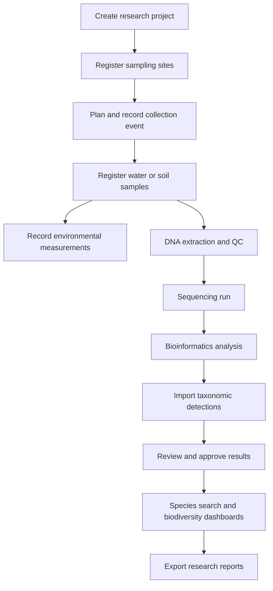
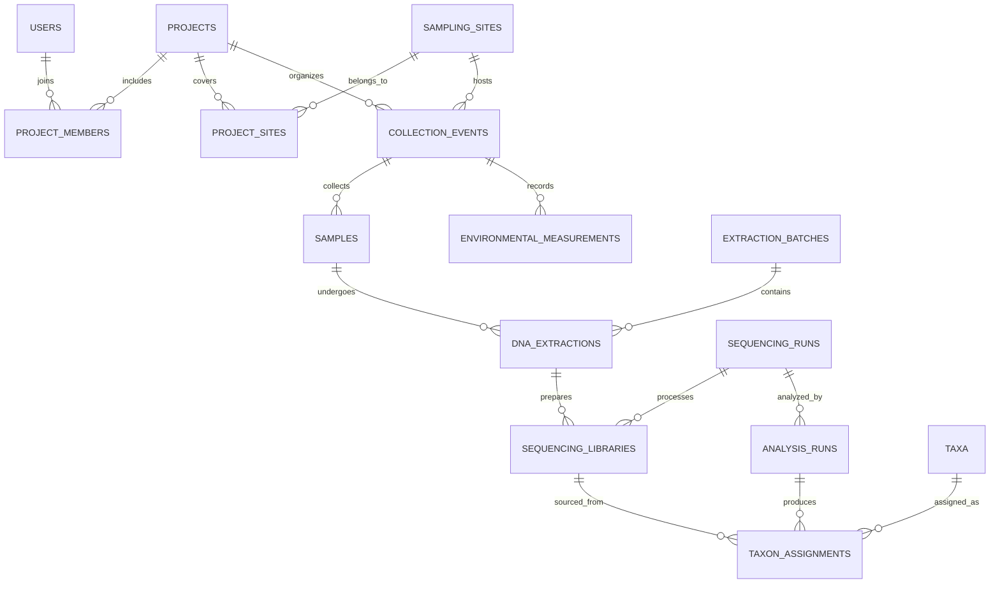

# eBioTrack — eDNA Biodiversity Intelligence Platform

> A database-first research management and biodiversity analytics web application for environmental DNA (eDNA) studies.

## 1. Project overview

eBioTrack helps environmental researchers manage the full lifecycle of environmental DNA research: research projects, field sites, collection events, samples, laboratory processing, sequencing runs, bioinformatics analyses, species detections, and biodiversity trends. It combines a React interface, a Node.js/Express API, and a PostgreSQL relational database. An optional Python ML service supports exploratory predictions and anomaly detection.

**Project type:** DBMS semester-end full-stack project  
**Primary focus:** Relational database modeling, integrity, complex SQL, transactions, indexing, security, and analytics  
**Proposed stack:** React, TypeScript or JavaScript, Node.js, Express, PostgreSQL, SQL, optional Python/scikit-learn  
**Working title:** eBioTrack

## 2. Problem statement

Environmental DNA projects generate related data across field sampling, laboratory work, sequencing, taxonomy, and environmental measurements. Information can become fragmented across spreadsheets, sequencing result files, and research notebooks, making it difficult to trace a species detection to its original sample, compare sites consistently, audit changes, or analyze trends over time.

**Proposed solution:** A centralized, relational, role-aware platform that connects every step of the research workflow and exposes searchable records, reproducible analyses, maps, and historical biodiversity dashboards.

## 3. Target audience and benefits

| User | Needs | eBioTrack benefit |
|---|---|---|
| Field researcher | Register sites, events, and samples | Standardized sample provenance |
| Lab technician | Track extraction, quality control, sequencing | Traceable processing history |
| Bioinformatics analyst | Import and review taxonomic assignments | Versioned, queryable detection results |
| Principal investigator | Coordinate projects and collaborators | Project oversight and access control |
| Conservation researcher | Compare biodiversity across sites/time | Trend dashboards and exports |
| Administrator | Manage users, permissions, and audit trails | Reliable governance |

The platform is intended as a research workflow and analysis system, not a DNA sequencing instrument or a substitute for scientific validation.

## 4. Main objectives

1. Model a scientifically plausible eDNA workflow with normalized relational tables.
2. Preserve provenance from a species detection back to an analysis run, sample, event, and site.
3. Support reliable multi-user data entry with constraints, transactions, and audit history.
4. Enable complex species, location, time, and environmental queries.
5. Visualize biodiversity records through dashboards and maps.
6. Import representative real or synthetic research datasets.
7. Optionally explore ML-based anomaly detection or species-detection predictions.

## 5. End-to-end workflow



A single sequencing run may contain multiple libraries/samples; a sample may be reprocessed or reanalyzed. The schema must preserve those many-to-many and versioning relationships rather than assuming a one-to-one pipeline.

## 6. Main application modules

### 6.1 Authentication and roles
- Login, session management, password hashing, role-based permissions.
- Roles: administrator, principal investigator, field researcher, lab technician, analyst, viewer.
- Project-specific membership and permissions.

### 6.2 Project and site management
- Create projects and invite members.
- Define study areas, geolocated sampling sites, habitat types, and site metadata.
- View sampling sites on a map.

### 6.3 Field sample management
- Register collection events and individual samples with unique identifiers.
- Record date, collector, sample type, collection depth, storage details, and environmental conditions.
- Track sample state and custody/handling history.

### 6.4 Laboratory workflow
- Record extraction batches and extraction records.
- Capture QC measurements and lab notes.
- Link extracted material to sequencing libraries and sequencing runs.
- Flag failed or contaminated controls.

### 6.5 Analysis and taxonomy
- Record analysis pipeline, version, marker, reference database, and run parameters.
- Import taxonomic detection results from CSV.
- Store taxonomic assignments and supporting confidence/quality metrics.
- Allow review and approval before results enter published dashboards.

### 6.6 Biodiversity intelligence
- Species/taxon detections by site, period, project, or habitat.
- Observed taxon richness and detection frequency.
- Compare matched sampling periods and methods.
- Download filtered CSV reports.

**Scientific caveat:** eDNA detection does not automatically establish organism abundance or confirmed absence. Non-detection may result from sampling effort, assay sensitivity, or analysis choices. Show uncertainty, effort, and quality flags in reports.

### 6.7 Optional ML module
- Detect unusual changes in observed richness or detection profiles.
- Estimate detection probability where adequate labeled, standardized data exists.
- Store model versions, input dataset versions, predictions, and evaluation metrics.
- Clearly label predictions as exploratory, not verified species occurrences.

## 7. Technology stack

| Layer | Recommended technology | Purpose |
|---|---|---|
| Frontend | React + TypeScript | Interactive web interface |
| UI | Tailwind CSS | Styling |
| Charts | Recharts | Trend visualization |
| Maps | Leaflet + OpenStreetMap | Sampling site map |
| API | Node.js + Express | Validation, workflows, endpoints |
| Main database | PostgreSQL | Relational storage and SQL |
| Geospatial (optional) | PostGIS | Geographic search |
| Database access | `pg` or a query builder | Parameterized SQL access |
| Authentication | Secure cookie-based sessions | Login and authorization |
| ML (optional) | Python, pandas, scikit-learn | Exploratory modeling |
| Version control | Git + GitHub | Collaboration |

**Primary programming languages:** SQL, TypeScript/JavaScript, and optionally Python. HTML/CSS are used for frontend markup and styling.

## 8. Proposed relational database schema

A practical complete design contains approximately **25 core tables**. These are proposed tables, not an implemented schema. Names and boundaries should be refined during normalization.

| # | Table | Important columns / purpose |
|---|---|---|
| 1 | `users` | `user_id` PK, name, email, password_hash, active |
| 2 | `roles` | `role_id` PK, role_name |
| 3 | `user_roles` | `user_id` FK, `role_id` FK |
| 4 | `projects` | `project_id` PK, title, objectives, start_date, status |
| 5 | `project_members` | `project_id` FK, `user_id` FK, project_role |
| 6 | `regions` | `region_id` PK, name, region_type, parent_region_id FK |
| 7 | `sampling_sites` | `site_id` PK, region_id FK, name, latitude, longitude, habitat_type |
| 8 | `project_sites` | `project_id` FK, `site_id` FK |
| 9 | `collection_events` | `event_id` PK, project_id FK, site_id FK, collector_id FK, collected_at |
| 10 | `sample_types` | `sample_type_id` PK, type_name |
| 11 | `samples` | `sample_id` PK, event_id FK, sample_type_id FK, sample_code, status |
| 12 | `environmental_measurements` | `measurement_id` PK, event_id FK, parameter, value, unit |
| 13 | `laboratories` | `lab_id` PK, name, location |
| 14 | `extraction_batches` | `batch_id` PK, lab_id FK, operator_id FK, extraction_date |
| 15 | `dna_extractions` | `extraction_id` PK, sample_id FK, batch_id FK, concentration, qc_status |
| 16 | `sequencing_runs` | `run_id` PK, lab_id FK, platform, run_date, status |
| 17 | `sequencing_libraries` | `library_id` PK, extraction_id FK, run_id FK, library_code |
| 18 | `dna_markers` | `marker_id` PK, marker_name, target_region |
| 19 | `analysis_runs` | `analysis_id` PK, run_id FK, marker_id FK, pipeline_version, reference_db, status |
| 20 | `taxa` | `taxon_id` PK, scientific_name, rank, parent_taxon_id FK |
| 21 | `taxon_assignments` | `assignment_id` PK, analysis_id FK, library_id FK, taxon_id FK, read_count, confidence, qc_flag |
| 22 | `quality_control_results` | `qc_id` PK, sample_id FK nullable, analysis_id FK nullable, qc_type, result |
| 23 | `sample_status_history` | `history_id` PK, sample_id FK, old_status, new_status, changed_by FK, changed_at |
| 24 | `audit_logs` | `audit_id` PK, actor_id FK, entity_type, entity_id, action, created_at |
| 25 | `data_exports` | `export_id` PK, requested_by FK, project_id FK, export_type, created_at |

**Additional constraints:** unique sample codes; positive/nonnegative values where appropriate; valid coordinate ranges; foreign keys; unique composite keys on junction tables; valid status transitions. For production-grade provenance, analysis inputs should be linked more precisely than a run-level relationship when libraries are re-used across multiple analyses.

### 8.1 Key relationships

- `users` M:N `roles` via `user_roles`.
- `users` M:N `projects` via `project_members`.
- `projects` M:N `sampling_sites` via `project_sites`.
- `sampling_sites` 1:N `collection_events`.
- `collection_events` 1:N `samples` and 1:N `environmental_measurements`.
- `samples` 1:N `dna_extractions` (supports repeats).
- `extraction_batches` 1:N `dna_extractions`.
- `dna_extractions` 1:N `sequencing_libraries`.
- `sequencing_runs` 1:N `sequencing_libraries` and 1:N `analysis_runs`.
- `analysis_runs` 1:N `taxon_assignments`.
- `taxa` 1:N `taxon_assignments`; `taxa` has a self-referencing taxonomy hierarchy.
- `samples` 1:N `sample_status_history`.

### 8.2 Simplified ER diagram



## 9. DBMS syllabus coverage

| Concept | Demonstration in eBioTrack |
|---|---|
| ER/EER modeling | Entity relationships, specialization of user roles, sample workflow |
| Keys and constraints | PK, FK, UNIQUE, CHECK, NOT NULL |
| Normalization | Decompose sample/species/site flat records into 3NF/BCNF tables |
| Relational algebra | Selection, projection, joins, set operations |
| Complex SQL | Multi-table JOINs, correlated subqueries, CTEs, aggregation |
| Views | Approved detections, project sample summaries, site richness |
| Indexes | Sample code, collection date, project/site, taxon lookup |
| Stored procedures/functions | Register sample, finalize analysis, calculate site metrics |
| Triggers | Audit important changes, enforce workflow transitions |
| Transactions | Atomic result import and analysis finalization |
| Concurrency | Prevent double finalization and conflicting edits |
| Authorization | Role and project-level access checks |
| Backup/recovery | `pg_dump`, restore demonstration, recovery documentation |
| Data warehousing | Optional star schema for historical trend reporting |
| NoSQL | Optional extension only if justified; PostgreSQL JSONB may suffice |

**Important:** A large table count alone does not demonstrate good database design. Normalization, realistic constraints, correct joins, repeatable tests, and query plans matter more.

## 10. Example SQL queries

### 10.1 Taxa detected at a site

```sql
SELECT DISTINCT t.taxon_id, t.scientific_name
FROM taxa t
JOIN taxon_assignments ta ON ta.taxon_id = t.taxon_id
JOIN sequencing_libraries sl ON sl.library_id = ta.library_id
JOIN dna_extractions de ON de.extraction_id = sl.extraction_id
JOIN samples s ON s.sample_id = de.sample_id
JOIN collection_events ce ON ce.event_id = s.event_id
JOIN analysis_runs ar ON ar.analysis_id = ta.analysis_id
WHERE ce.site_id = $1
  AND ar.status = 'approved'
  AND ta.qc_flag = 'pass';
```

### 10.2 Sample count per site

```sql
SELECT ss.name, COUNT(s.sample_id) AS sample_count
FROM sampling_sites ss
LEFT JOIN collection_events ce ON ce.site_id = ss.site_id
LEFT JOIN samples s ON s.event_id = ce.event_id
GROUP BY ss.site_id, ss.name
ORDER BY sample_count DESC;
```

### 10.3 Taxon richness by site and year (illustrative)

```sql
SELECT ce.site_id,
       EXTRACT(YEAR FROM ce.collected_at) AS year,
       COUNT(DISTINCT ta.taxon_id) AS observed_taxa
FROM taxon_assignments ta
JOIN analysis_runs ar ON ar.analysis_id = ta.analysis_id
JOIN sequencing_libraries sl ON sl.library_id = ta.library_id
JOIN dna_extractions de ON de.extraction_id = sl.extraction_id
JOIN samples s ON s.sample_id = de.sample_id
JOIN collection_events ce ON ce.event_id = s.event_id
WHERE ar.status = 'approved'
  AND ta.qc_flag = 'pass'
GROUP BY ce.site_id, EXTRACT(YEAR FROM ce.collected_at)
ORDER BY ce.site_id, year;
```

For scientific comparisons, additionally control for marker, pipeline, effort, replication, and quality thresholds. Repeated analyses can otherwise inflate reported richness or detections.

## 11. Transactions, triggers, and indexing

### Transaction example

When approving an analysis, perform these actions atomically:

1. Verify analyst permissions and QC results.
2. Lock the relevant analysis record (`SELECT ... FOR UPDATE`).
3. Validate and insert/import accepted detection rows.
4. Mark analysis as approved.
5. Write an audit event.
6. Commit, or roll back everything on failure.

### Trigger examples

- Write an audit entry after changes to sample status.
- Reject invalid workflow transitions.
- Prevent modification of approved results except through a controlled revision workflow.

### Suggested indexes

```sql
CREATE UNIQUE INDEX idx_samples_code ON samples(sample_code);
CREATE INDEX idx_events_site_date ON collection_events(site_id, collected_at);
CREATE INDEX idx_assignments_taxon ON taxon_assignments(taxon_id);
CREATE INDEX idx_assignments_analysis ON taxon_assignments(analysis_id);
```

Measure index effects using `EXPLAIN (ANALYZE, BUFFERS)` on a sufficiently large test dataset.

## 12. Frontend pages

1. **Login / access control:** Sign in and project permissions.
2. **Dashboard:** Projects, sites, samples, approved detections, recent activity.
3. **Projects:** Create, edit, and manage collaborators.
4. **Sampling map:** Interactive site map and filters.
5. **Collection events:** Field event forms and environmental measurements.
6. **Samples:** Searchable registry, detail page, status timeline.
7. **Lab processing:** Extraction, QC, sequencing workflow.
8. **Analysis import:** Upload CSV, preview errors, validate, commit.
9. **Species explorer:** Taxonomy, detected sites, detection history.
10. **Biodiversity analytics:** Site/time comparisons and exportable charts.
11. **Administration:** Users, roles, audit records, backups.
12. **ML insights (optional):** Anomalies, predictions, model limitations.

## 13. Backend API sketch

| Method | Endpoint | Action |
|---|---|---|
| `POST` | `/api/auth/login` | Authenticate |
| `GET` | `/api/projects` | List accessible projects |
| `POST` | `/api/projects` | Create project |
| `GET` | `/api/sites` | Filter sampling sites |
| `POST` | `/api/events` | Register collection event |
| `POST` | `/api/samples` | Register sample |
| `GET` | `/api/samples/:id` | Sample detail and history |
| `POST` | `/api/extractions` | Register DNA extraction |
| `POST` | `/api/analyses/import` | Validate result import |
| `POST` | `/api/analyses/:id/approve` | Transactional approval |
| `GET` | `/api/taxa/:id/detections` | Detection history |
| `GET` | `/api/analytics/richness` | Richness by site/period |
| `GET` | `/api/audit` | Authorized audit history |

Implement input validation, parameterized queries, pagination, consistent errors, and server-side authorization for every protected endpoint.

## 14. AI/ML component (optional)

### Recommended first model: anomaly detection

**Inputs:** standardized site/period richness, environmental variables, and sampling effort.  
**Output:** flags for observations that differ substantially from comparable historical observations.

**Workflow:**

```text
Approved PostgreSQL records
       ↓
Feature extraction and quality filters
       ↓
Python model training / evaluation
       ↓
Model version + anomaly scores
       ↓
Stored results in PostgreSQL
       ↓
Dashboard with caveats
```

**Feasibility caution:** ML requires sufficient consistent data; with sparse observations, use transparent statistical thresholds or omit ML. Do not treat an eDNA non-detection as confirmed absence, and do not display predicted probabilities as calibrated without validation.

## 15. Data sourcing and import

Potential public data sources include:

- [OBIS](https://obis.org/) — ocean biodiversity occurrence data, including DNA-derived datasets.
- [GBIF](https://www.gbif.org/) — biodiversity occurrence and DNA-derived data publication ecosystem.
- [NCBI SRA](https://www.ncbi.nlm.nih.gov/sra) — raw sequencing archives (more advanced; not required for the MVP).

**Data plan:** Start with a curated CSV fixture and synthetic workflow records; then import an appropriately licensed public dataset whose fields map cleanly to the schema. Preserve source attribution, license, identifiers, and whether records are real or synthetic. Public datasets may not contain every laboratory workflow field; do not fabricate missing metadata and label simulated records clearly.

## 16. Example use case

A researcher creates **Yamuna Biodiversity Survey**, registers several sampling sites, records monthly water collection events, and uploads validated analysis results. The platform links each taxonomic assignment back to the relevant sample, sequencing run, collection date, and site. The researcher filters for a taxon, compares approved detections across sites, reviews environmental conditions, and exports a report. An administrator can trace who changed each record.

This is an illustrative workflow, not a claim that such a dataset has been collected.

## 17. Suggested repository structure

```text
ebiotrack/
├── frontend/
│   ├── src/components/
│   ├── src/pages/
│   ├── src/services/
│   └── src/hooks/
├── backend/
│   ├── src/routes/
│   ├── src/controllers/
│   ├── src/services/
│   ├── src/middleware/
│   └── src/db/
├── database/
│   ├── migrations/
│   ├── seeds/
│   ├── views/
│   ├── procedures/
│   ├── triggers/
│   └── queries/
├── ml/                      # optional
├── datasets/
├── docs/
│   ├── er-diagram.md
│   ├── normalization.md
│   ├── api.md
│   └── dbms-demonstration.md
├── tests/
└── README.md
```

## 18. Implementation roadmap

| Phase | Deliverable | Priority |
|---|---|---|
| 1 | Requirements, ER/EER model, normalization report | Essential |
| 2 | PostgreSQL schema, constraints, seed data | Essential |
| 3 | Authentication, projects, sites, sample registry APIs | Essential |
| 4 | React project/site/sample management UI | Essential |
| 5 | Extraction, sequencing, analysis import workflow | Essential |
| 6 | Complex SQL, views, triggers, transactions, indexes | Essential |
| 7 | Species explorer, map, biodiversity charts | Essential |
| 8 | Query-plan benchmarks, role tests, backup/restore | Essential |
| 9 | Data warehouse and ML experiments | Optional |

**MVP boundary:** Implement the complete core relational workflow and at least one meaningful analytics page before adding ML or a separate NoSQL database.

## 19. Testing and evaluation

- **Integrity tests:** Invalid foreign keys, duplicate sample codes, illegal status transitions.
- **Transaction tests:** Inject import errors and verify full rollback.
- **Concurrency tests:** Simulate simultaneous approval attempts.
- **Authorization tests:** Ensure unauthorized users cannot view/edit restricted projects.
- **Query tests:** Verify counts and joins on known seed fixtures.
- **Performance tests:** Compare indexed vs non-indexed query plans.
- **Recovery tests:** Restore a database backup and verify key records.
- **Scientific checks:** Label QC failures, replicate analyses, uncertain assignments, and non-detections appropriately.

## 20. Semester-final demonstration plan

1. Show ER/EER diagram and explain important cardinalities.
2. Demonstrate normalization from a denormalized sample sheet.
3. Register a site, collection event, and sample through the UI.
4. Record extraction and sequencing metadata.
5. Import a detection CSV with validation and transaction rollback on an invalid row.
6. Open the species explorer and trace a detection to its original sample.
7. Run multi-join SQL, aggregate, view, and stored procedure examples.
8. Demonstrate a trigger-generated audit log and role restriction.
9. Compare `EXPLAIN ANALYZE` results before and after indexing.
10. Show backup/restore; optionally demonstrate ML anomaly results.

## 21. Feasibility and limitations

**Feasible:** The application can be developed using existing datasets, synthetic lab records, and a normal web stack. It does not require laboratory access or physical DNA sequencing.

**Key challenges:** Understanding biological metadata, cleaning imported datasets, avoiding duplicated detections from repeat analyses, preserving analysis provenance, and ensuring scientifically meaningful comparisons.

**Scope control:** Do not build a DNA sequence classifier or sequencing pipeline from scratch. The platform records outputs from external bioinformatics workflows. Do not promise real-time species monitoring without live validated data feeds.

## 22. Future enhancements

- Darwin Core-compatible export for biodiversity data sharing.
- More complete taxonomic reference integration and synonym handling.
- Spatial search and geofencing using PostGIS.
- Sample chain-of-custody and barcode support.
- Repeatable analytical pipelines and richer provenance.
- Multi-institution collaboration and public datasets portal.
- Carefully validated ML models with explicit uncertainty.
- Analytical warehouse with periodic snapshots.

## 23. Expected outcomes

The final project should deliver a working web application, a normalized and documented PostgreSQL database, representative research records, complex SQL demonstrations, role-aware APIs, biodiversity visualizations, integrity and transaction tests, and a reproducible semester-final demo.

**Core principle:** eBioTrack is a **DBMS-centered environmental research platform**, not merely a dashboard or a machine-learning classifier.
